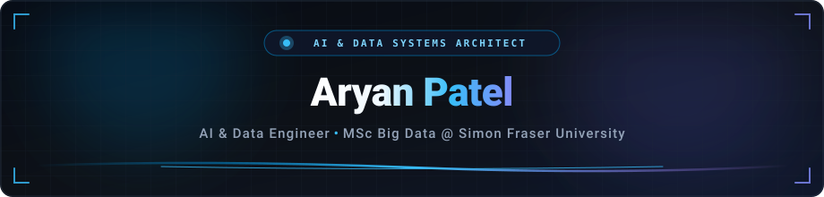
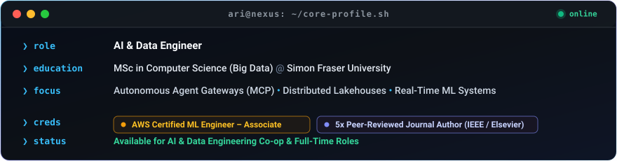

<!-- Modern Glowing Header Banner (Served Locally for 100% Uptime & Speed) -->

<!-- Dynamic Animated Typing Line -->

 

<!-- Modern Pill Badges -->

  &nbsp;
  &nbsp;
  &nbsp;
  

---

<!-- Sleek Cyber Terminal Card -->

---

### ⚡ Tech Stack

---

### 🚀 Featured Systems & Production Demos

> **Note:** *Source code repositories are maintained privately under enterprise / academic governance. Interactive live production deployments and endpoints are accessible below:*

<table>
  <tr>
    <td width="50%" valign="top">
      <h3>🚢 ANCHOR: Distributed Maritime AIS Telemetry & Lakehouse</h3>
      

        
        
      

      

        
        
        
        
        
      

      <ul>
        <li><b>Medallion Lakehouse Pipeline:</b> Distributed big data architecture processing <b>200M+ maritime AIS telemetry records</b> on AWS EMR Serverless & S3 into partitioned Parquet layers.</li>
        <li><b>Spatial Proximity Engine:</b> Executes distributed geospatial joins to detect offshore ship-to-ship cargo transfers and illicit vessel loitering patterns.</li>
        <li><b>Predictive MLlib Modeling:</b> Trained Spark MLlib Gradient-Boosted Trees (GBT) to forecast vessel dwell times, exposing analytical marts via Amazon Athena and AWS Lambda.</li>
      </ul>
    </td>
    <td width="50%" valign="top">
      <h3>🛡️ FraudShield AI: Real-Time Risk Scoring Microservice</h3>
      

        
        
      

      

        
        
        
        
        
        
      

      <ul>
        <li><b>Real-Time Inference Microservice:</b> Sub-millisecond fraud detection service built in FastAPI, integrating an in-process DuckDB & dbt pipeline for rolling transaction velocity aggregations.</li>
        <li><b>Imbalance-Calibrated ML:</b> Cost-sensitive XGBoost classifier calibrated for severe transaction class imbalance, maintaining near-zero tolerance for false negatives.</li>
        <li><b>Explainability & Drift Sentinel:</b> Pairs SHAP TreeExplainer for real-time feature attribution with a Population Stability Index (PSI) monitor to detect production covariate drift.</li>
      </ul>
    </td>
  </tr>
  <tr>
    <td width="50%" valign="top">
      <h3>🥗 Pantri+: Autonomous Multimodal Inventory & Recipe Agent</h3>
      

        
        
      

      

        
        
        
        
        
      

      <ul>
        <li><b>Multimodal Vision Ingestion:</b> Extracts grocery items, quantities, and expiration dates from receipt and shelf photos into Supabase PostgreSQL using Gemini Vision and Pydantic schemas.</li>
        <li><b>Agentic Recipe Synthesis:</b> LangGraph multi-agent state machine utilizing <code>pgvector</code> semantic search to synthesize customized recipes adhering to on-hand inventory and allergen constraints.</li>
        <li><b>Autonomous Inventory Sync:</b> Employs fuzzy token matching to automatically deduct ingredient quantities from persistent storage upon meal preparation.</li>
      </ul>
    </td>
    <td width="50%" valign="top">
      <h3>📑 Tally: Agentic Financial Disclosure & SEC EDGAR Auditor</h3>
      

        
        
      

      

        
        
        
        
        
      

      <ul>
        <li><b>Automated Disclosure Audit:</b> Cross-references executive claims and forward-looking statements from corporate earnings calls against verified SEC EDGAR 10-K/10-Q filings.</li>
        <li><b>Hybrid Vector & Keyword RAG:</b> Implements Reciprocal Rank Fusion over <code>pgvector</code> dense embeddings and BM25 sparse keyword indices to pinpoint granular disclosure tables.</li>
        <li><b>Variance & Citation Engine:</b> Reconciles reported metrics, computing percentage variances and rendering auditable source references to eliminate ungrounded financial claims.</li>
      </ul>
    </td>
  </tr>
</table>

---

### 🔬 Applied Research & Publications

  
  
  

---

### 📊 GitHub Activity

 

<!-- Sleek Footer Accent Line -->

  

